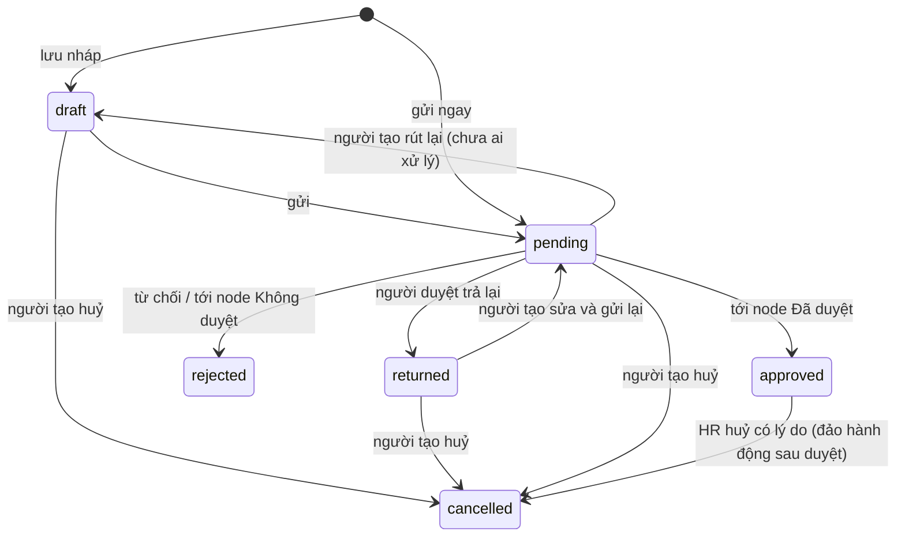

# Thiết kế: Engine phê duyệt và đơn từ

Backlog: `AP-04` → `AP-26`, `LV-01` → `LV-25`, `AT-22`, `AU-21` · Phase 3 · Trạng thái: **Bản nháp 2026-11-26, chờ duyệt**. Mục 13 là các điểm cần HR / người phụ trách chốt trước khi code.

## 1. Vấn đề

Hiện tại:

- **Cấu hình quy trình đã có, engine thì chưa.** `ApprovalWorkflowDefinition` lưu sơ đồ (`flowDefinition`) do màn thiết kế kiểu 1Office tạo ra (AP-01 → AP-03, AP-09), nhưng không có gì chạy sơ đồ đó.
- **Hộp duyệt là giả.** `GET /approvals` và `POST /approvals/:id/decision` đọc / ghi `mock-data` (AP-14, AP-15). Bảng `ApprovalRequest` có trong DB nhưng không dùng.
- **Đơn nghỉ chỉ đọc được.** `LeaveRequest` có trong DB (LV-01), nhưng không có API tạo đơn, không có quỹ phép, không có loại nghỉ.
- **Sáu form đơn chỉ là giao diện** (nghỉ, vắng mặt, làm thêm, giải trình chấm công, đổi ca, thôi việc). Chưa form nào gửi dữ liệu (LV-16 → LV-21).
- **Bảng công chưa biết đơn.** Engine tính công Phase 2 đã chừa loại adjustment `leave`, `overtime`, `explanation`, `shift_swap`, `business_trip` ([attendance-engine.md](attendance-engine.md) mục 6.6), nhưng chưa có gì ghi vào.

Mục tiêu theo roadmap: nhân viên tạo đơn → đúng người duyệt → kết quả tự cập nhật vào công và quỹ phép → người tạo nhận thông báo.

## 2. Mục tiêu và ngoài phạm vi

Mục tiêu:

- **Một engine cho mọi loại đơn.** Đơn nghỉ, OT, đổi ca… chỉ khác ở phần dữ liệu riêng và hành động sau khi duyệt. Phase 7–8 (tuyển dụng, trình ký văn bản, quyết định nhân sự) dùng lại cùng engine.
- **Chạy đúng sơ đồ người dùng vẽ**, không đổi định dạng `flowDefinition` hiện có, chỉ thêm trường.
- **Đơn đang chạy không bị ảnh hưởng khi sửa quy trình.** Mỗi đơn gắn với một phiên bản quy trình cố định.
- **Mọi bước và mọi hành động đều được lưu** để có timeline, audit và báo cáo.
- **Hành động sau duyệt chạy trong cùng transaction** với lần duyệt cuối. Không có chuyện đơn đã duyệt mà quỹ phép chưa trừ.

Ngoài phạm vi:

- Tính tiền OT, tiền nghỉ có lương: Phase 5. Phase 3 chỉ ghi số giờ / số công vào bảng công.
- Trình ký văn bản có chữ ký số: Phase 8 (`DC`), dùng lại engine này.
- Form động cho đề xuất chung (LV-23): chỉ chừa chỗ (`payload` JSON + schema theo loại), làm ở 3b.
- Nhánh song song trong sơ đồ (một node đi ra nhiều bước duyệt cùng lúc): chưa hỗ trợ, xem mục 5.4.

## 3. Khái niệm

| Khái niệm | Nghĩa |
|---|---|
| **Đơn** (`Request`) | Một yêu cầu của nhân viên: loại, dữ liệu riêng của loại, trạng thái. |
| **Loại đơn** (`type`) | `leave`, `absence`, `overtime`, `checkin_out`, `shift_change`, `resignation`; 3b thêm `business_trip`, `proposal`. |
| **Quy trình** (`ApprovalWorkflowDefinition`) | Cấu hình đang có: đối tượng áp dụng, sơ đồ, cài đặt quá hạn… |
| **Phiên bản quy trình** (`ApprovalWorkflowVersion`) | Bản chụp sơ đồ tại một thời điểm. Đơn trỏ tới phiên bản, không trỏ tới quy trình. |
| **Bước** (`ApprovalStep`) | Một lần đơn đi qua một node duyệt trong sơ đồ. Qua cùng node hai lần (sau khi trả lại) thì có hai bước. |
| **Người được giao** (`ApprovalAssignee`) | Một người phải / được phép xử lý một bước. Một bước có thể có nhiều người. |
| **Hành động** (`ApprovalAction`) | Ai làm gì, lúc nào: duyệt, từ chối, trả lại, chuyển tiếp, bình luận, tự động… |
| **Bộ xử lý loại đơn** (`RequestTypeHandler`) | Code riêng của từng loại: kiểm tra dữ liệu, tính số ngày, việc làm khi duyệt / huỷ. |

## 4. Vòng đời đơn



- **Rút lại** (`recall`, LV-06): chỉ khi chưa ai ở bước hiện tại hành động. Đơn về `draft`, các bước đang mở đóng lại với trạng thái `cancelled`.
- **Gửi lại sau khi bị trả**: chạy lại từ đầu sơ đồ, dùng **phiên bản đang hoạt động mới nhất** của quy trình (vì người tạo đã sửa đơn, điều kiện có thể khác). Các bước cũ giữ nguyên trong timeline.
- **Huỷ đơn đã duyệt**: chỉ người có `permission.requests.manage`, bắt buộc lý do, gọi `onCancelledAfterApproval` của loại đơn (hoàn quỹ phép, xoá adjustment công, tính lại công). Nếu ngày bị ảnh hưởng thuộc kỳ công đã chốt thì từ chối. Nhân viên muốn huỷ đơn đã duyệt thì tạo đơn huỷ (3b, ngoài phạm vi 3a).

## 5. Engine

### 5.1 Chọn quy trình (AP-10)

Khi gửi đơn:

1. Lấy các quy trình `status = active` có `objectType` khớp loại đơn.
2. Lọc theo `subObject`: khớp chính xác (ví dụ loại nghỉ `annual`) hoặc `all`.
3. Nhiều quy trình khớp: ưu tiên `subObject` chính xác hơn `all`, rồi quy trình cập nhật mới nhất. Ghi lại lựa chọn vào audit.
4. Không quy trình nào khớp: dùng **quy trình mặc định dựng sẵn**, gồm một bước "Quản lý trực tiếp" (`automatic:direct_manager`) → Đã duyệt. Đơn được gắn cờ `usedDefaultWorkflow` và hiện ở trang cảnh báo duyệt (AP-24) để admin biết cần cấu hình.

Màn thiết kế hiện chỉ có đối tượng `personnel_profile` và `decision`. Cần thêm nhóm **Đơn từ** với sáu loại đơn ở mục 3, và `subObject` của đơn nghỉ là danh sách loại nghỉ (LV-09).

### 5.2 Định dạng sơ đồ

Giữ nguyên định dạng màn thiết kế đang lưu: `{ nodes, edges, startNodePosition, edgeStyle }`. Node có `type` là `start`, `approval`, `condition`, `notification`, `email`, `approved`, `rejected`. Edge có `source`, `target` và `branch` (`default`, `matched`, `unmatched`, `matched:<slotId>`, `unmatched:<slotId>`).

Thêm vào `approvalConfig` của node duyệt (màn thiết kế cần thêm ô chọn):

| Trường | Giá trị | Mặc định |
|---|---|---|
| `approvalMode` | `any` (một người duyệt là đủ) · `all` (tất cả phải duyệt) | `any` |
| `selfApproval` | `skip` (người duyệt trùng người tạo thì bỏ qua bước) · `allow` | `skip` |
| `allowReturn` | Cho phép trả lại | `true` |
| `allowForward` | Cho phép chuyển tiếp | `true` |

`approverId`, `followerId`, `substituteId` hiện là một chuỗi. Engine chấp nhận cả chuỗi lẻ lẫn danh sách cách nhau bằng dấu phẩy, để màn thiết kế sau này cho chọn nhiều người mà không phải đổi dữ liệu.

**Kiểm tra sơ đồ khi lưu và khi kích hoạt** (thêm vào AP-04, AP-08): có đúng một `start`; mọi node tới được từ `start`; mọi đường đi đều kết thúc ở `approved` hoặc `rejected`; không có vòng lặp; node duyệt có người duyệt; node điều kiện có nhánh `unmatched`; chỉ node điều kiện được có nhiều cạnh đi ra. Sơ đồ không hợp lệ thì không bật được quy trình.

### 5.3 Chạy sơ đồ

Engine là một vòng lặp đi từ node hiện tại theo cạnh, **dừng ở node duyệt** (chờ người) hoặc **ở node kết thúc**:

| Node | Engine làm gì |
|---|---|
| `start` | Đi theo cạnh `default`. |
| `approval` | Xác định người duyệt (5.5), tạo `ApprovalStep` + `ApprovalAssignee`, gửi thông báo cho họ (AP-23), **dừng**. Nếu không còn ai sau khi bỏ người tạo (`selfApproval = skip`) thì ghi hành động `auto_skipped` và đi tiếp. |
| `condition` | Đánh giá điều kiện (5.6), đi theo nhánh tương ứng. |
| `notification` / `email` | Đưa vào hàng đợi gửi qua dịch vụ thông báo NT-05 (sau khi đơn chuyển trạng thái thành công, không gửi trong transaction), đi tiếp. Nội dung đã được lọc HTML phía server (AP-25). |
| `approved` | Đơn → `approved`, gọi `onApproved` của loại đơn trong cùng transaction, báo người tạo và người theo dõi. |
| `rejected` | Đơn → `rejected`, báo người tạo. |

Mỗi lần chạy có giới hạn 100 bước để chặn sơ đồ hỏng lọt qua kiểm tra. Vượt giới hạn thì đơn giữ `pending`, ghi lỗi và hiện ở trang cảnh báo.

### 5.4 Tuần tự, song song, một người đủ (AP-12)

- **Tuần tự**: các node duyệt nối tiếp nhau trên sơ đồ.
- **Song song**: một node duyệt có nhiều người, `approvalMode = all`. Mọi người nhận việc cùng lúc, bước xong khi tất cả duyệt; một người từ chối là bước bị từ chối.
- **Một người đủ**: `approvalMode = any`. Người đầu tiên quyết định; việc của những người còn lại đóng với trạng thái `superseded`.

Nhánh song song kiểu "từ một node chia ra hai bước duyệt rồi gộp lại" không hỗ trợ ở Phase 3: 1Office không có, và nhu cầu đó được đáp ứng bằng `approvalMode = all`.

### 5.5 Xác định người duyệt (AP-11)

Xác định **lúc bước được mở**, không phải lúc gửi đơn, để dùng sơ đồ tổ chức mới nhất.

| Giá trị trong cấu hình | Ra những ai |
|---|---|
| `<employeeId>` | Đúng người đó. |
| `automatic:direct_manager` | `Employee.managerId` của người tạo. Không có thì lấy trưởng phòng của người tạo (`Department.headId`); người tạo chính là trưởng phòng thì lấy trưởng phòng cha. |
| `automatic:creator_supervisor` | Quản lý của quản lý trực tiếp (cấp trên hai bậc), cùng cách lùi như trên. |
| `department:<id>` | Trưởng phòng ban đó (`headId`). |
| `position:<id>` | Mọi nhân sự đang làm vị trí đó **trong cùng đơn vị** với người tạo (phạm vi `branch`, [data-scope.md](data-scope.md) mục 3). |
| `title:<id>` | Như `position`, theo chức vụ. |
| `dynamic:*` | Không dùng cho người duyệt (chỉ dùng cho người nhận thông báo / email). |

Sau đó:

1. Bỏ người đã nghỉ việc, tài khoản bị khoá.
2. Thêm người được uỷ quyền nếu người duyệt đang vắng (5.8).
3. Bỏ người tạo đơn nếu `selfApproval = skip`.
4. **Không còn ai**: thêm `substituteId` của node. Vẫn không có ai thì giao cho những người có quyền `permission.approvals.manage` và gắn cờ `needsAttention` để hiện ở trang cảnh báo duyệt (AP-24). Đơn không bao giờ bị kẹt mà không ai thấy.

Danh sách người được giao lưu vào `ApprovalAssignee` cùng **nguồn** (`resolvedFrom`: `direct_manager`, `delegation`, `substitute`, `fallback_admin`…) để timeline giải thích được vì sao người đó phải duyệt.

**Khi người được giao nghỉ việc / đổi phòng sau khi bước đã mở**: luồng nghỉ việc (HR-17) gọi engine xác định lại người duyệt cho các bước đang mở của người đó. Đổi phòng không tự giao lại; HR dùng chuyển tiếp (AP-17).

### 5.6 Điều kiện

Dữ liệu dùng để so là một bản ghi phẳng dựng từ đơn:

- Trường chung (đang có trên màn thiết kế): `created_by`, `department`, `position`, `job_title`, `status`, `created_at`, `approval_deadline`. `approval_by` và `approved_at` là của bước duyệt gần nhất.
- Trường riêng của từng loại đơn, do `RequestTypeHandler.conditionFields()` khai báo. Ví dụ đơn nghỉ: `leave_type`, `total_days`, `paid`; đơn OT: `total_hours`, `is_holiday`. Màn thiết kế lấy danh sách trường theo đối tượng đã chọn (thêm API `GET /approval-workflows/condition-fields?objectType=`).

Quy tắc đánh giá:

- Trong một nhóm, các mệnh đề nối bằng **VÀ**; giữa các nhóm là **HOẶC** (cần chốt, mục 13).
- Node có nhiều ô điều kiện: xét lần lượt theo thứ tự; ô đầu tiên đúng thì đi theo cạnh `matched:<slotId>`. Không ô nào đúng thì đi theo cạnh `unmatched` của node.
- So số và ngày theo kiểu dữ liệu của trường; `contains` dùng cho chuỗi và danh sách. Hàm `ROUND`, `MONTH`, `YEAR` áp lên vế trái.
- Trường không có giá trị thì mọi phép so trả về sai.

Bộ đánh giá là **hàm thuần** `evaluate(condition, record)`, test theo bảng trường hợp.

### 5.7 Hành động duyệt (AP-15 → AP-19)

| Hành động | Ai | Kết quả |
|---|---|---|
| Duyệt | Người được giao ở bước đang mở | Theo `approvalMode` (5.4). Bước xong thì engine đi tiếp. |
| Từ chối | Như trên, bắt buộc lý do | Bước và đơn → `rejected`. Không đi theo sơ đồ nữa (1Office cũng vậy). |
| Trả lại | Như trên, bắt buộc lý do, khi node `allowReturn` | Đơn → `returned`, người tạo sửa và gửi lại (mục 4). |
| Chuyển tiếp | Như trên, khi node `allowForward` | Thay mình bằng người khác trong bước này; ghi `forwardedFrom`. |
| Duyệt hàng loạt | Người duyệt chọn nhiều đơn | Mỗi đơn xử lý trong transaction riêng; trả về kết quả từng đơn (đơn lỗi không chặn đơn khác). |
| Bình luận | Người tạo, người được giao (kể cả bước cũ), người theo dõi, HR có phạm vi | Lưu `RequestComment`; sau khi duyệt xong thì theo `allowDiscussionAfterApproved`. |

Mọi hành động kiểm tra **phiên bản đơn** (`Request.version`, tăng mỗi lần đổi trạng thái) để hai người duyệt cùng lúc không ghi đè nhau: ai tới sau nhận lỗi 409 "Đơn đã được xử lý".

### 5.8 Uỷ quyền (AU-21, AP-22)

`ApprovalDelegation`: người uỷ quyền, người nhận, từ ngày, đến ngày, loại đơn áp dụng (rỗng = tất cả), trạng thái.

- Khi mở bước, người duyệt đang trong thời gian uỷ quyền thì **người nhận được thêm vào** cùng bước (`resolvedFrom = delegation`, `onBehalfOfId`). Người uỷ quyền vẫn duyệt được.
- Uỷ quyền tạo **sau** khi bước đã mở thì áp cho các bước đang mở của người đó.
- Không uỷ quyền nối tiếp (A → B → C chỉ tới B).

### 5.9 Quá hạn và nhắc (AP-21)

- Bước có `dueAt` = lúc mở bước + `deadlineDays/Hours/Minutes` của node, tính theo giờ đồng hồ (tính theo giờ làm việc là câu hỏi số 5 ở mục 13).
- Job BullMQ chạy mỗi 15 phút: bước quá hạn thì xử lý theo `overdueAction` của node, node để `none` thì theo `overdueAction` của quy trình:
  - `none`: nhắc người được giao và người theo dõi bước, mỗi ngày một lần.
  - `auto_approve` / `auto_reject`: hệ thống hành động thay, ghi `actorType = system`.
  - `substitute`: thêm `substituteId` vào bước.
- Trước hạn 1 giờ gửi một lần nhắc.

### 5.10 Người theo dõi (AP-20)

Gộp từ: `followerId` của quy trình, `followerId` của node, và người tạo chọn thêm trong form ("Đối tượng liên quan"). Người theo dõi xem được đơn và nhận thông báo khi đơn đổi trạng thái, không duyệt được.

## 6. Bộ xử lý loại đơn

```ts
interface RequestTypeHandler<P> {
  type: RequestType;
  payloadSchema: ClassConstructor<P>;            // DTO class-validator cho payload
  validate(payload: P, ctx): Promise<void>;      // trùng ngày, vượt quỹ phép, kỳ đã chốt...
  summarize(payload: P, ctx): RequestSummary;    // tiêu đề, khoảng ngày, số ngày/giờ cho danh sách
  conditionFields(): ConditionFieldDef[];        // trường cho node điều kiện
  conditionRecord(payload: P, ctx): Record<string, unknown>;
  onSubmitted?(tx, request): Promise<void>;      // ví dụ giữ chỗ quỹ phép
  onWithdrawn?(tx, request): Promise<void>;      // rút / huỷ / từ chối: nhả chỗ
  onApproved(tx, request): Promise<void>;        // trừ phép, ghi adjustment công
  onCancelledAfterApproval(tx, request): Promise<void>;
}
```

| Loại | Dữ liệu chính | Khi duyệt | Item |
|---|---|---|---|
| `leave` | loại nghỉ, các khoảng thời gian (ngày + giờ, nhiều dòng như form), lý do, file | Trừ quỹ phép; ghi adjustment `leave` cho từng ngày; tính lại công | LV-09 → LV-16 |
| `absence` | các khoảng ra ngoài trong giờ làm, lý do | Adjustment `absence` (không trừ công nếu loại "việc công ty") | LV-17 |
| `overtime` | ngày, giờ bắt đầu / kết thúc, loại OT (ngày thường / nghỉ / lễ) | Adjustment `overtime` (số giờ được duyệt) | LV-18 |
| `checkin_out` | ngày, giờ vào và / hoặc ra cần bổ sung, lý do | Adjustment `explanation` (coi như có log) | LV-20 |
| `shift_change` | ngày, ca cũ → ca mới (hoặc đổi với người khác) | Đổi `ShiftAssignment`; tính lại công | LV-19 |
| `resignation` | ngày nghỉ dự kiến, lý do | Ghi ngày nghỉ việc vào hồ sơ; tạo checklist offboarding khi có RC | LV-21 |

**Kỳ công đã chốt**: không tạo, không duyệt, không huỷ được đơn có ngày nằm trong kỳ đã chốt (AT-17). Báo lỗi nêu rõ tháng nào cần mở chốt.

**Nhiều đơn cùng ngày**: đơn nghỉ trùng ngày / trùng giờ với một đơn nghỉ khác đang `pending` hoặc `approved` thì chặn (LV-15). Đơn OT và giải trình cùng ngày với đơn nghỉ thì cho phép, engine công cộng dồn theo thứ tự ưu tiên ở mục 8.

## 7. Nghỉ phép

### 7.1 Loại nghỉ (LV-09)

`LeaveType`: mã, tên, có lương / không lương, **trừ quỹ phép** hay không, đơn vị tối thiểu (`day`, `half_day`, `hour`), số ngày tối đa mỗi đơn, bắt buộc đính kèm giấy tờ, giới tính áp dụng, trạng thái.

Dựng sẵn theo Bộ luật Lao động (HR sửa được): Phép năm (trừ quỹ), Nghỉ ốm (BHXH, không trừ quỹ, cần giấy), Nghỉ không lương, Kết hôn (3 ngày, có lương), Con kết hôn (1 ngày), Tang (3 ngày), Thai sản.

### 7.2 Quỹ phép (LV-10 → LV-14)

Sổ cái, không sửa số trực tiếp:

- `LeaveBalance` (nhân sự × loại nghỉ × năm): `entitled`, `carriedOver`, `adjusted`, `used`, `pending`, `expired`. Số dư khả dụng = `entitled + carriedOver + adjusted − used − pending − expired`.
- `LeaveBalanceTransaction`: mọi thay đổi (cộng hằng tháng, chuyển năm, hết hạn, điều chỉnh tay, giữ chỗ, dùng, hoàn) đều là một dòng có lý do, nguồn (đơn nào / job nào / ai).

Quy tắc mặc định (mục 13 cần HR xác nhận):

| Quy tắc | Mặc định |
|---|---|
| Phép năm | 12 ngày / năm, +1 ngày mỗi 5 năm thâm niên |
| Cách cộng | Cộng 1/12 mỗi tháng vào ngày 1 (job BullMQ), làm tròn 0,5 |
| Vào giữa năm | Tháng vào làm được cộng nếu vào trước ngày 15 |
| Thử việc | Được cộng nhưng chưa được dùng (chặn khi tạo đơn) |
| Phép tồn | Chuyển sang năm sau, hết hạn ngày 31/03 |
| Nghỉ vượt quỹ | Chặn |
| Giữ chỗ khi gửi đơn | Có: số ngày vào `pending`, nhả ra khi từ chối / huỷ / rút |

### 7.3 Tính số ngày nghỉ (LV-15)

Dùng lịch ca của Phase 2: chỉ tính ngày có ca (hoặc ngày làm việc theo chính sách nếu chưa xếp ca), bỏ ngày lễ. Nghỉ nửa ngày: theo giờ nghỉ giữa ca của ca hôm đó. Nghỉ theo giờ: giờ nghỉ / số giờ của ca × số công của ca. Hàm thuần, test theo bảng trường hợp (ca thường, ca đêm, có ngày lễ giữa kỳ nghỉ, nửa ngày sáng / chiều).

## 8. Cập nhật bảng công (AT-22)

`onApproved` ghi adjustment vào bảng adjustment của engine công (đã có loại `manual`), mỗi ngày một dòng, `sourceRequestId` trỏ về đơn, rồi đưa ngày vào hàng đợi tính lại (đã có từ AT-12).

Engine công áp theo thứ tự: log máy → giải trình (`explanation`) → đổi ca → nghỉ (`leave`, `absence`) → OT → sửa tay của HR (`manual`, luôn thắng). Sửa tay của HR không bị đơn ghi đè.

Huỷ đơn đã duyệt: xoá các adjustment có `sourceRequestId` đó, tính lại.

## 9. API

| Route | Việc | Item |
|---|---|---|
| `POST /requests` | Tạo đơn (`submit: true` thì gửi luôn, không thì lưu nháp) | LV-02 |
| `GET /requests?box=mine\|to_approve\|following\|all` | Danh sách, lọc loại / trạng thái / khoảng ngày, phân trang chuẩn | LV-03 |
| `GET /requests/:id` | Chi tiết, kèm bước hiện tại, quyền hành động của người xem | LV-04 |
| `PATCH /requests/:id` | Sửa nháp / đơn bị trả lại | LV-05 |
| `POST /requests/:id/submit`, `/recall`, `/cancel` | Gửi, rút, huỷ | LV-06 |
| `GET/POST /requests/:id/comments` | Bình luận | LV-07 |
| `POST /requests/:id/attachments` | Đính kèm (file service, mục đích `request_attachment`) | LV-08 |
| `GET /approvals` | Hộp duyệt: bước đang chờ tôi (kể cả do uỷ quyền) | AP-14 |
| `POST /approvals/:stepId/decision` | `{ action: approve\|reject, reason }` | AP-15 |
| `POST /approvals/:stepId/return`, `/forward` | Trả lại, chuyển tiếp | AP-16, AP-17 |
| `POST /approvals/bulk` | Duyệt / từ chối hàng loạt | AP-18 |
| `GET /approvals/:requestId/timeline` | Bước + hành động + thông báo đã gửi | AP-19 |
| `GET/POST/PATCH/DELETE /delegations` | Uỷ quyền | AU-21 |
| `GET/POST/PATCH/DELETE /leave-types` | Loại nghỉ | LV-09 |
| `GET /leave-balances/me`, `GET /leave-balances`, `POST /leave-balances/adjust` | Quỹ phép | LV-10 → LV-12 |
| `GET /leave-requests/calendar` | Lịch nghỉ phòng ban | LV-25 |

`GET /leave-requests` (LV-01) giữ lại như một bộ lọc của `/requests?type=leave` để không gãy chỗ đang gọi, rồi bỏ ở Phase 9.

## 10. Quyền

| Việc | Khoá quyền |
|---|---|
| Tạo, xem, sửa, rút, huỷ đơn của mình | Chỉ cần đăng nhập |
| Xem đơn mình được giao duyệt / theo dõi | Chỉ cần là người được giao / theo dõi (kể cả bước đã qua) |
| Xem đơn của người khác | `permission.requests.view` (có phạm vi dữ liệu) |
| Huỷ đơn đã duyệt, giao lại người duyệt | `permission.requests.manage` (có phạm vi) |
| Cấu hình quy trình, xem trang cảnh báo duyệt | `permission.approvals.manage` |
| Loại nghỉ, điều chỉnh quỹ phép | khoá mới `permission.leave.manage` (có phạm vi cho điều chỉnh) |
| Xem quỹ phép của người khác | `permission.requests.view` (có phạm vi) |
| Uỷ quyền của mình | Chỉ cần đăng nhập; tạo hộ người khác cần `permission.approvals.manage` |

Mọi hành động ghi audit log (CORE-13); `ApprovalAction` là timeline nghiệp vụ, không thay audit log.

## 11. Mô hình dữ liệu (tóm tắt)

```prisma
enum RequestStatus { draft pending returned approved rejected cancelled }
enum ApprovalStepStatus { active approved rejected returned skipped cancelled }
enum ApprovalAssigneeStatus { pending approved rejected returned forwarded superseded }

model Request {
  id                 String        @id @default(uuid())
  code               String        @unique           // DN-2026-000123
  type               String
  requesterId        String
  status             RequestStatus @default(draft)
  title              String
  payload            Json                            // theo payloadSchema của loại đơn
  fromDate           DateTime?                       // tóm tắt để lọc / lịch
  toDate             DateTime?
  quantity           Decimal?                        // số ngày / giờ
  workflowVersionId  String?
  usedDefaultWorkflow Boolean      @default(false)
  needsAttention     Boolean       @default(false)
  version            Int           @default(1)       // khoá lạc quan
  submittedAt        DateTime?
  decidedAt          DateTime?
  cancelReason       String?
  createdAt          DateTime      @default(now())
  updatedAt          DateTime      @updatedAt
  @@index([requesterId, status])
  @@index([type, status])
  @@index([fromDate, toDate])
}

model ApprovalWorkflowVersion {
  id             String   @id @default(uuid())
  workflowId     String
  version        Int
  flowDefinition Json
  settings       Json     // overdueAction, followerId, allow*AfterApproved tại thời điểm chụp
  createdAt      DateTime @default(now())
  @@unique([workflowId, version])
}

model ApprovalStep {
  id         String             @id @default(uuid())
  requestId  String
  nodeId     String
  name       String
  mode       String             // any | all
  status     ApprovalStepStatus @default(active)
  round      Int                // lần gửi thứ mấy (tăng sau mỗi lần trả lại)
  dueAt      DateTime?
  openedAt   DateTime           @default(now())
  closedAt   DateTime?
  @@index([requestId])
  @@index([status, dueAt])
}

model ApprovalAssignee {
  id            String                 @id @default(uuid())
  stepId        String
  employeeId    String
  resolvedFrom  String                 // employee | direct_manager | department_head | position | delegation | substitute | fallback_admin | forward
  onBehalfOfId  String?
  status        ApprovalAssigneeStatus @default(pending)
  actedAt       DateTime?
  @@unique([stepId, employeeId])
  @@index([employeeId, status])
}

model ApprovalAction {
  id         String   @id @default(uuid())
  requestId  String
  stepId     String?
  actorId    String?            // null khi hệ thống
  actorType  String             // user | system
  action     String             // submit | approve | reject | return | forward | recall | cancel | auto_skipped | auto_approve | auto_reject | reminder
  reason     String?
  data       Json?
  createdAt  DateTime @default(now())
  @@index([requestId, createdAt])
}

model RequestFollower { requestId String; employeeId String; source String; @@id([requestId, employeeId]) }
model RequestComment  { id String @id @default(uuid()); requestId String; authorId String; body String; createdAt DateTime @default(now()) }
model ApprovalDelegation { id String @id @default(uuid()); delegatorId String; delegateId String; fromDate DateTime; toDate DateTime; requestTypes String[]; status String; createdAt DateTime @default(now()) }

model LeaveType { /* mục 7.1 */ }
model LeaveBalance { /* mục 7.2, @@unique([employeeId, leaveTypeId, year]) */ }
model LeaveBalanceTransaction { /* mục 7.2 */ }
```

File đính kèm dùng `FileObject` đã có (CORE-11) với `ownerType = request`.

**Chuyển dữ liệu:**

- `ApprovalRequest` (không dùng, chỉ có dữ liệu mock): xoá bảng.
- `LeaveRequest`: chép sang `Request` với `type = leave`, trạng thái giữ nguyên, payload một khoảng `fromDate → toDate`, loại nghỉ ánh xạ theo mã cũ. Không trừ quỹ phép cho đơn cũ (quỹ phép đầu kỳ HR nhập tay qua LV-12 hoặc import). Sau đó xoá bảng.
- `ApprovalWorkflowDefinition`: mỗi quy trình hiện có sinh phiên bản 1 từ `flowDefinition` hiện tại.

## 12. Thứ tự triển khai

Tách theo gợi ý roadmap.

**3a: engine + nghỉ phép** (đủ tiêu chí hoàn thành của roadmap)

1. Schema + migration (mục 11), chuyển dữ liệu `LeaveRequest`.
2. Phiên bản quy trình, sửa / chi tiết / bật tắt / nhân bản, kiểm tra sơ đồ (AP-04 → AP-08), lọc HTML server (AP-25).
3. Bộ đánh giá điều kiện và xác định người duyệt: hàm thuần + test bảng trường hợp (AP-11).
4. Engine chạy sơ đồ, chọn quy trình, lưu bước / hành động (AP-10, AP-12, AP-13).
5. API đơn chung + hộp duyệt + duyệt / từ chối / trả lại / timeline (LV-02 → LV-07, AP-14 → AP-16, AP-19).
6. Loại nghỉ, quỹ phép, tính số ngày, cộng phép tự động (LV-09 → LV-15).
7. Form đơn nghỉ + trang danh sách đơn + hộp duyệt nối API thật (LV-16, LV-24, LV-01).
8. Cập nhật công sau duyệt (AT-22, phần nghỉ), thông báo người duyệt / người tạo (AP-23).

**3b: các loại đơn còn lại và vận hành**

9. Đơn vắng mặt, OT, giải trình, đổi ca, thôi việc (LV-17 → LV-21) + AT-22 cho từng loại.
10. Chuyển tiếp, duyệt hàng loạt, người theo dõi, đính kèm (AP-17, AP-18, AP-20, LV-08).
11. Uỷ quyền, quá hạn (AU-21, AP-22, AP-21), trang cảnh báo duyệt (AP-24), đính kèm email (AP-26).
12. Đơn công tác, đề xuất chung, lịch nghỉ phòng ban (LV-22, LV-23, LV-25).

**Test bắt buộc**

- Unit bảng trường hợp: chạy sơ đồ (tuần tự, `any`, `all`, điều kiện nhiều ô, trả lại rồi gửi lại, tự bỏ qua khi người duyệt là người tạo, không tìm ra người duyệt → admin, vượt 100 bước); xác định người duyệt (không có quản lý, người tạo là trưởng phòng, người duyệt nghỉ việc, uỷ quyền); điều kiện (VÀ / HOẶC, ngày, số, trường rỗng); tính số ngày nghỉ; quỹ phép (cộng tháng, thâm niên, chuyển năm, hết hạn, giữ chỗ / nhả chỗ).
- Unit đồng thời: hai người duyệt cùng lúc trên bước `any` → một thành công, một nhận 409.
- E2E (supertest): 401/403 cho mọi route mới; người không liên quan không xem được đơn.
- Đầu–cuối (Playwright theo roadmap): tạo đơn nghỉ phép → quản lý duyệt → quỹ phép giảm → bảng công ghi nghỉ phép → người tạo nhận thông báo.

## 13. Cần chốt trước khi code

| # | Câu hỏi | Đề xuất trong bản nháp |
|---|---|---|
| 1 | Điều kiện: trong nhóm là VÀ, giữa các nhóm là HOẶC? | Có (giống 1Office) |
| 2 | Không có quy trình khớp thì dùng quy trình mặc định "quản lý trực tiếp duyệt", hay chặn không cho tạo đơn? | Dùng mặc định + cảnh báo admin |
| 3 | Người duyệt trùng người tạo (trưởng phòng tự xin nghỉ): bỏ qua bước hay vẫn tự duyệt? | Bỏ qua, chuyển bước sau; nếu là bước cuối thì lên cấp trên |
| 4 | Gửi lại sau khi bị trả: chạy lại từ đầu hay từ bước đã trả? | Từ đầu |
| 5 | Thời hạn duyệt tính theo giờ đồng hồ hay giờ làm việc? | Giờ đồng hồ ở Phase 3 |
| 6 | Quỹ phép: 12 ngày + thâm niên, cộng theo tháng, tồn hết hạn 31/03, thử việc chưa được dùng, cấm nghỉ vượt quỹ? | Như mục 7.2 |
| 7 | Nhân viên có được tự huỷ đơn đã duyệt không, hay phải qua HR / đơn huỷ? | Qua HR ở 3a; đơn huỷ ở 3b |
| 8 | `position:` / `title:` lấy người cùng đơn vị hay toàn công ty? | Cùng đơn vị (`branch`) |
| 9 | Quỹ phép đầu kỳ khi go-live: HR import từ Excel? | Có, qua import Excel đã có (CORE-18) |

## 14. Rủi ro

- **Đơn kẹt không ai duyệt** (người duyệt nghỉ, phòng ban không có trưởng phòng). Cách giảm: lùi theo 5.5, cuối cùng giao admin và hiện ở trang cảnh báo; job hằng ngày liệt kê đơn `pending` quá 3 ngày không có hành động.
- **Sửa quy trình làm hỏng đơn đang chạy.** Cách giảm: đơn trỏ tới phiên bản cố định; sửa quy trình luôn sinh phiên bản mới.
- **Quỹ phép lệch** do sửa trực tiếp. Cách giảm: chỉ ghi qua sổ cái giao dịch, số dư tính lại được từ sổ cái; test đối chiếu.
- **Phase lớn** (~50 item). Cách giảm: chia 3a / 3b như mục 12, 3a đã đủ luồng đầu–cuối của roadmap.
