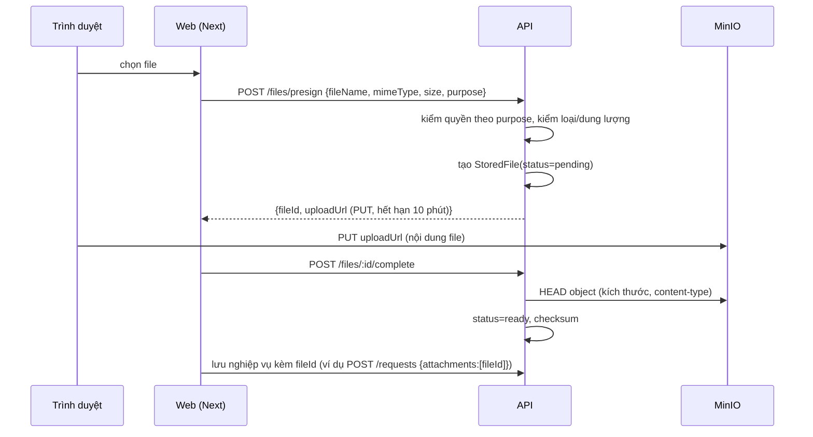

# Thiết kế: Lưu trữ file (MinIO / S3)

Backlog: `CORE-11`, `CORE-12` (và mở khoá `HR-07`, `CT-12`, `LV-08`, `AP-26`, `WP-09`, `AT-14`, `DC-*`) · Phase 1 · Trạng thái: **Đã chốt 2026-10-20** (xem mục 9)

## 1. Hiện trạng

- Tài liệu hồ sơ nhân sự lưu **trong Postgres** (`EmployeeDocument.content Bytes`), gửi lên dạng base64 trong body JSON của `POST/PATCH /employees`. Vì vậy API phải nhận body tới 25MB (`app.setup.ts`) và web phải đặt `serverActions.bodySizeLimit = 25mb`.
- MinIO đã chạy trong `docker-compose.yml`, `.env` đã có `S3_ENDPOINT`, `S3_BUCKET`, `S3_ACCESS_KEY`, `S3_SECRET_KEY` nhưng chưa có code dùng.
- Nhiều chức năng sắp làm cần file: đính kèm đơn từ, scan hợp đồng, ảnh check-in, ảnh bài viết, đính kèm email quy trình, kho tài liệu.

Lưu file trong DB làm phình backup, chậm truy vấn và không hợp với ảnh/tài liệu lớn. Cần một dịch vụ file dùng chung.

## 2. Mô hình

```prisma
model StoredFile {
  id           String    @id @default(uuid())
  bucket       String
  objectKey    String    @unique          // <purpose>/<yyyy>/<mm>/<uuid>-<tên đã chuẩn hoá>
  fileName     String                     // tên gốc hiển thị
  mimeType     String
  size         Int
  checksum     String?                    // sha256, điền sau khi xác nhận upload
  purpose      String                     // employee_document | contract_scan | request_attachment | checkin_photo | post_media | workflow_attachment | document
  ownerType    String?                    // Employee | Contract | ApprovalRequest | Post ...
  ownerId      String?
  status       StoredFileStatus @default(pending)  // pending | ready | deleted
  uploadedById String?                    // UserAccount.id
  createdAt    DateTime  @default(now())
  deletedAt    DateTime?

  @@index([ownerType, ownerId])
}
```

Các bảng nghiệp vụ chỉ giữ `fileId` (hoặc bảng nối), không giữ nội dung.

## 3. Luồng upload (presigned, trình duyệt gửi thẳng lên MinIO)



- API **không** nhận nội dung file → bỏ được giới hạn body 25MB (giữ 1MB cho JSON).
- `POST /files` (multipart qua API) giữ làm phương án dự phòng cho script/máy chấm công, giới hạn 10MB.
- File `pending` quá 24 giờ bị job dọn dẹp xoá (cần `CORE-16` BullMQ; trước đó chạy bằng cron đơn giản).

## 4. Luồng tải xuống

`GET /files/:id` → kiểm quyền → trả **302** tới URL presigned GET hết hạn sau 5 phút (`Content-Disposition` theo `fileName`). Không bao giờ để bucket public.

Kiểm quyền theo `purpose` + `owner`:

| purpose | Ai được tải |
|---|---|
| employee_document | Chính nhân sự đó; người có quyền xem hồ sơ trong phạm vi dữ liệu (`data-scope.md`) |
| contract_scan | Như trên với quyền hợp đồng |
| request_attachment | Người tạo đơn, người duyệt / theo dõi đơn |
| post_media | Mọi người thấy được bài viết |
| checkin_photo | Chính nhân sự, người có quyền quản lý chấm công trong phạm vi |

Mỗi module đăng ký một `FileAccessPolicy` cho `purpose` của mình; `FilesService` gọi policy tương ứng — không có quy tắc chung kiểu "ai đăng nhập cũng tải được".

## 5. Giới hạn và an toàn (`CORE-12`)

- Danh sách MIME cho phép theo `purpose` (ví dụ ảnh: jpeg/png/webp; tài liệu: pdf, docx, xlsx, jpeg, png).
- Dung lượng tối đa: ảnh 10MB, tài liệu 25MB (cấu hình qua env).
- Kiểm tra lại kích thước và content-type thật bằng `HEAD` ở bước `complete`; không tin giá trị client gửi.
- Tên object không dùng tên gốc để tránh ký tự lạ/đường dẫn; tên gốc chỉ nằm trong DB.
- Quét virus (ClamAV) để sau, ghi chú trong `CORE-12`; khi có thì thêm trạng thái `scanning`.
- Mọi upload/xoá ghi audit log.

## 6. Chuyển dữ liệu cũ

Migration + script `npm run files:migrate-employee-documents`:

1. Với mỗi `EmployeeDocument`: đẩy `content` lên MinIO, tạo `StoredFile(purpose=employee_document, owner=Employee)`, ghi `fileId` vào `EmployeeDocument`.
2. Kiểm tra số lượng và checksum khớp.
3. Bản phát hành sau mới xoá cột `content`.

`GET /employees/:id/documents/:documentId` giữ nguyên đường dẫn, bên trong chuyển sang redirect file service — web không phải đổi ngay.

## 7. Cấu hình

`S3_ENDPOINT`, `S3_REGION`, `S3_BUCKET`, `S3_ACCESS_KEY`, `S3_SECRET_KEY` (đã có), thêm `S3_PUBLIC_ENDPOINT` (địa chỉ trình duyệt truy cập được MinIO, khác địa chỉ nội bộ khi chạy Docker/LAN). Thư viện: `@aws-sdk/client-s3` + `@aws-sdk/s3-request-presigner` (MinIO tương thích S3) để sau này đổi sang S3/R2 không phải sửa code. API tạo bucket khi khởi động nếu chưa có.

## 8. Kiểm thử

- Unit: kiểm tra MIME/dung lượng, sinh object key, policy theo purpose.
- E2E (MinIO thật trong CI qua service container): presign → PUT → complete → GET trả 302; người ngoài phạm vi nhận 404; file sai loại bị từ chối ở presign; `complete` khi object chưa tồn tại trả 409.

## 9. Quyết định đã chốt (2026-10-20)

1. **Ảnh tối đa 10MB, tài liệu tối đa 25MB**, chỉnh được qua biến môi trường `FILE_MAX_IMAGE_MB`, `FILE_MAX_DOCUMENT_MB`.
2. **Chưa làm phiên bản file** ở Phase 1; thay file = tạo `StoredFile` mới, file cũ chuyển `deleted`. Phiên bản để `DC-04`.
