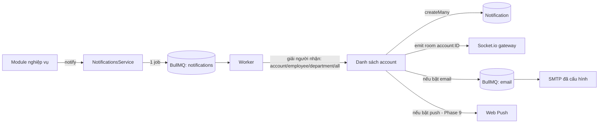

# Thiết kế: Thông báo (in-app, realtime, email, push)

Backlog: `NT-02` → `NT-08`, `CORE-16`, `CORE-17` (và phục vụ `AP-23`, `AT-23`, `TK-09`, `WP-07`, `CT-13`) · Phase 1 · Trạng thái: **Đã chốt 2026-10-20** (xem mục 9)

## 1. Hiện trạng

- `Notification(id, userId String, event, title, body, readAt)` — `userId` không có khoá ngoại, không có đường dẫn mở chi tiết, chưa có dữ liệu thật; `GET /notifications/unread` trả mock và nhận `userId` từ query (ai cũng xem được của người khác).
- `NotificationsGateway` (socket.io, namespace `notifications`) chỉ có handler demo, đã bị guard toàn cục chặn từ Phase 0.
- SMTP đã cấu hình được (`admin-settings/smtp`, mật khẩu mã hoá, có gửi thử). Redis chạy sẵn, gói `bullmq` / `@nestjs/bullmq` đã cài nhưng chưa có hàng đợi.

## 2. Mục tiêu

Một điểm vào duy nhất cho mọi module:

```ts
await this.notifications.notify({
  event: "approval.assigned",
  recipients: { accountIds: [assigneeAccountId] },   // hoặc { employeeIds }, { departmentIds }, { all: true }
  title: "Bạn có đơn nghỉ phép cần duyệt",
  body: "Nguyễn Hải Anh · 22–23/10",
  link: "/user/requests/detail?id=…",
  data: { requestId },
  actorAccountId
});
```

Module nghiệp vụ không tự gửi email hay socket.

## 3. Mô hình

```prisma
model Notification {
  id          String    @id @default(uuid())
  accountId   String                          // người nhận (UserAccount)
  account     UserAccount @relation(fields: [accountId], references: [id], onDelete: Cascade)
  event       String                          // approval.assigned, leave.approved, contract.expiring...
  title       String
  body        String?
  link        String?                         // đường dẫn trong web để mở chi tiết
  data        Json?
  actorId     String?                         // ai gây ra sự kiện
  readAt      DateTime?
  createdAt   DateTime  @default(now())

  @@index([accountId, readAt, createdAt])
}

model NotificationPreference {
  accountId String
  event     String                            // hoặc "*" cho mặc định
  inApp     Boolean @default(true)
  email     Boolean @default(false)
  push      Boolean @default(false)
  @@id([accountId, event])
}

model NotificationEventType {                 // danh mục sự kiện, seed sẵn
  key            String  @id                  // approval.assigned
  module         String
  label          String
  defaultEmail   Boolean @default(false)
  mandatory      Boolean @default(false)      // người dùng không tắt được (ví dụ: phiếu lương)
}
```

Migration đổi `userId` → `accountId` (bảng hiện chưa có dữ liệu thật).

## 4. Luồng xử lý



- `notify()` chỉ đẩy **một job** rồi trả về ngay → giao dịch nghiệp vụ không chờ gửi email.
- Gửi thông báo **sau khi** giao dịch nghiệp vụ commit (gọi `notify` sau `$transaction`, hoặc dùng bảng outbox nếu cần đảm bảo tuyệt đối — để sau).
- Worker gộp người nhận trùng, bỏ người gây ra sự kiện (`actorAccountId`) nếu sự kiện không yêu cầu.
- Email: hàng đợi riêng, retry 3 lần (backoff mũ), giới hạn tốc độ theo cấu hình SMTP. Nội dung dựng từ mẫu (`ST-11` sau này; trước đó dùng mẫu mặc định trong code).

## 5. Realtime (`CORE-17`)

- Xác thực **lúc handshake**: client gửi access token trong `auth.token`; gateway verify bằng `AuthService` như HTTP, gắn `socket.data.account`, sai thì ngắt kết nối.
- Mỗi socket vào room `account:<id>`; worker emit `notification.created` vào room đó.
- Bỏ handler demo `notification.preview`. Client không được gửi sự kiện phát tán.
- Guard toàn cục (`JwtAuthGuard`) tiếp tục từ chối message WS; gateway không cần nhận message nào từ client ngoài kết nối.
- Web: token nằm trong cookie httpOnly nên client không đọc được → thêm route `GET /api/auth/socket-token` (Next) trả access token ngắn hạn cho socket, hoặc web mở socket qua cùng domain với cookie. Đề xuất: route socket-token (đơn giản, rõ ràng).

## 6. API

| Route | Mô tả |
|---|---|
| `GET /notifications?cursor=&unread=` | Danh sách của **tài khoản đang đăng nhập** (bỏ query `userId`) |
| `GET /notifications/unread-count` | Số chưa đọc cho badge |
| `POST /notifications/:id/read` | Đánh dấu đã đọc (chỉ của mình; người khác → 404) |
| `POST /notifications/read-all` | Đọc tất cả |
| `GET/PATCH /notification-preferences` | Bật/tắt theo sự kiện và kênh |

`GET /notifications/unread` hiện có: giữ làm alias của `unread-count` một thời gian rồi bỏ.

## 7. Hạ tầng BullMQ (`CORE-16`)

- Module `QueueModule` dùng `REDIS_URL`; hàng đợi: `notifications`, `email`, sau này `imports`, `reports`, `payroll`.
- Worker chạy **process riêng ngay từ đầu** (đã chốt): entry point `apps/api/src/worker.ts` dùng `NestFactory.createApplicationContext(WorkerModule)` — không mở cổng HTTP, dùng chung Prisma, cấu hình SMTP và `AuthService`. Script `npm run start:worker` / `start:worker:dev`; `npm run dev` ở root chạy thêm tiến trình `worker` bên cạnh `web` và `api`.
- API chỉ **đẩy job**; mọi xử lý (giải người nhận, ghi DB, gửi email) nằm ở worker. Emit socket từ worker qua `@socket.io/redis-emitter` (worker không giữ kết nối socket; API giữ, nghe qua Redis adapter).
- Health: worker ghi heartbeat vào Redis; `GET /health` (CORE-20) báo worker còn sống hay không.
- Bull Board (giao diện xem hàng đợi) chỉ cho `system_admin`, để sau.
- Khi Redis không chạy: API vẫn khởi động, `notify()` ghi log lỗi và ghi thẳng `Notification` vào DB (không email/realtime) để không mất thông báo trong app.

## 8. Kiểm thử

- Unit: giải người nhận (theo phòng ban, bỏ trùng, bỏ actor), áp preference (mandatory bỏ qua tắt).
- E2E: `notify` → bản ghi xuất hiện ở `GET /notifications` của đúng người, không xuất hiện ở người khác; `POST /notifications/:id/read` của người khác → 404; socket không token bị ngắt, socket có token nhận `notification.created`.
- Email: dùng transport giả trong test, kiểm tra nội dung và người nhận.

## 9. Quyết định đã chốt (2026-10-20)

1. **Email mặc định bật** cho: `approval.assigned` (có đơn cần duyệt), `request.approved` / `request.rejected` (đơn được duyệt / từ chối), `payslip.published` (**bắt buộc**, không tắt được), `contract.expiring` (cho HR). Các sự kiện khác chỉ in-app; người dùng tự bật email nếu muốn.
2. **Worker chạy process riêng** ngay từ đầu (xem mục 7).
