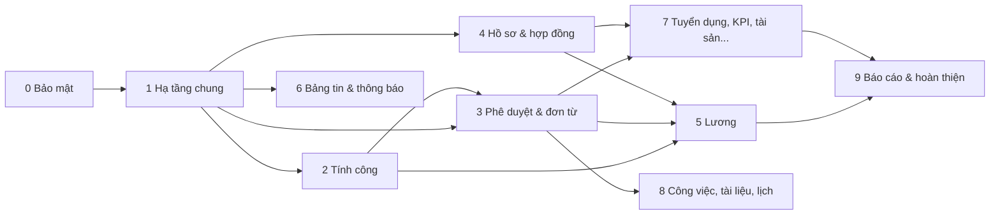

# Helios Office — Roadmap các phase

Tài liệu này là bản đồ tổng: mỗi phase làm gì, khi nào được bắt đầu, khi nào coi là xong, và phải chốt thiết kế gì trước khi code.

- **Làm những gì** (từng chức năng, API, trạng thái): [backlog.yaml](backlog.yaml). Xem phạm vi một phase: `npm run audit:features -- --phase N`.
- **Làm thế nào trong phase đang chạy** (task chi tiết, thứ tự commit): `docs/plans/phase-N.md`, viết khi bắt đầu phase.
- **Đã làm gì**: [progress-changelog.md](progress-changelog.md).

> Đánh số phase ở đây thay thế thứ tự Phase 0–10 trong [implementation-plan.md](implementation-plan.md). Tài liệu cũ giữ để tham khảo bối cảnh.

## Trạng thái các phase

Cập nhật bảng này mỗi khi bắt đầu hoặc đóng một phase.

| Phase | Tên | Trạng thái | Plan chi tiết | Ngày đóng |
|---|---|---|---|---|
| 0 | Vá bảo mật & chuẩn hoá repo | Xong, chờ merge `feat/phase-0` + CI trên GitHub | [phase-0.md](plans/phase-0.md) | |
| 1 | Hạ tầng dùng chung | Thiết kế đã chốt ([data-scope](design/data-scope.md), [file-storage](design/file-storage.md), [notification](design/notification.md)); chờ đóng Phase 0 | — | |
| 2 | Ca làm việc & engine tính công | Chưa bắt đầu | — | |
| 3 | Engine phê duyệt & đơn từ | Chưa bắt đầu | — | |
| 4 | Hồ sơ mở rộng & hợp đồng | Chưa bắt đầu | — | |
| 5 | Lương, bảo hiểm, thuế | Chưa bắt đầu | — | |
| 6 | Bảng tin & thông báo | Chưa bắt đầu | — | |
| 7 | Tuyển dụng, onboarding, đào tạo, KPI, tài sản | Chưa bắt đầu | — | |
| 8 | Công việc, tài liệu, lịch | Chưa bắt đầu | — | |
| 9 | Báo cáo, tích hợp, mobile, dọn nợ kỹ thuật | Chưa bắt đầu | — | |

Trạng thái: `Chưa bắt đầu` → `Đang thiết kế` → `Đang làm` → `Đã đóng`.

## Phụ thuộc giữa các phase

Phase 4 và 6 có thể chạy song song với 2–3 nếu có nhiều người. Phase 5 (lương) bắt buộc chờ 2, 3, 4.

## Quy trình chung cho mọi phase

**Khi bắt đầu phase:**

1. Kiểm tra điều kiện bắt đầu của phase (bên dưới) đã đạt.
2. Chạy `npm run audit:features -- --phase N` để lấy danh sách item.
3. Nếu phase có mục "Thiết kế cần chốt": viết `docs/design/<chủ-đề>.md` (schema Prisma, luồng, trường hợp biên) và duyệt trước khi code.
4. Viết `docs/plans/phase-N.md`: thứ tự task, mã item của từng task, cách kiểm tra từng task.
5. Đổi trạng thái phase trong bảng trên thành `Đang làm`.

**Trong khi làm:** mỗi task gắn mã item; xong task thì cập nhật `status` trong backlog và chạy audit.

**Khi đóng phase (gate bắt buộc):**

- [ ] `npm run typecheck` pass
- [ ] `npm run test` pass (gồm test mới của phase)
- [ ] `npm run build` pass
- [ ] `npm run audit:features -- --strict` không lỗi
- [ ] Mọi item của phase là `done` hoặc đã chuyển phase/`skipped` có ghi chú
- [ ] Đã test tay các luồng chính ghi trong "Tiêu chí hoàn thành"
- [ ] Đã thêm entry vào `progress-changelog.md`
- [ ] Đã cập nhật bảng trạng thái ở đầu tài liệu này
- [ ] Đã đọc mục của phase kế tiếp và ghi lại việc cần chuẩn bị

---

## Phase 0 — Vá bảo mật & chuẩn hoá repo

**Mục tiêu:** không còn route nào lộ dữ liệu khi chưa đăng nhập; repo có lint/CI để giữ chất lượng cho các phase sau.

**Điều kiện bắt đầu:** đã commit hoặc gác lại phần việc dở (rich editor `AP-09`).

**Phạm vi:** `CORE-01` → `CORE-09`.

**Thứ tự gợi ý:**

1. `.gitattributes` (CORE-09).
2. Guard toàn cục + `@Public` (CORE-01), rồi gắn permission cho 6 controller đang mở (CORE-02). Cập nhật script audit để hiểu guard toàn cục.
3. Proxy web (CORE-03), helmet + rate limit (CORE-04).
4. Gộp route trùng (CORE-05), bỏ fallback mock âm thầm (CORE-06).
5. ESLint (CORE-07), CI (CORE-08).

**Thiết kế cần chốt:** danh sách quyền cho các route mới gắn guard (ai được xem kỳ lương, hộp duyệt...).

**Tiêu chí hoàn thành:**

- Audit báo 0 route không có guard (trừ `@Public` có chủ đích).
- Gọi API không token → 401; token thiếu quyền → 403.
- Mở `/hcns`, `/apps/*`, `/social` khi chưa đăng nhập → về `/login`.
- CI chạy trên PR.

**Test trọng tâm:** dựng bộ test e2e API (supertest) đầu tiên — test 401/403 cho toàn bộ route. Bộ khung này dùng lại cho mọi phase sau.

**Rủi ro:** guard toàn cục ảnh hưởng mọi route — chạy impact analysis trước; kiểm tra lại máy chấm công vẫn sync được.

---

## Phase 1 — Hạ tầng dùng chung

**Mục tiêu:** có sẵn các "khối dùng chung" mà mọi nghiệp vụ phía sau cần, để không phải làm lại ở từng module.

**Điều kiện bắt đầu:** Phase 0 đã đóng.

**Phạm vi:** `CORE-10` → `CORE-20`, `AU-10` → `AU-20`, `NT-04`, `NT-05`.

**Thứ tự gợi ý:**

1. Phân trang/lọc chuẩn (CORE-10).
2. Phạm vi dữ liệu theo quyền (CORE-15, AU-10) — quan trọng nhất của phase.
3. Audit log interceptor + API xem (CORE-13, CORE-14).
4. File service MinIO (CORE-11, CORE-12).
5. BullMQ (CORE-16) → dịch vụ thông báo (NT-05) → WebSocket (CORE-17, NT-04).
6. Import/Export Excel (CORE-18, CORE-19).
7. Bổ sung tài khoản: đổi/quên mật khẩu, phiên, 2FA, lịch sử đăng nhập (AU-11 → AU-20).

**Thiết kế cần chốt (viết design doc):**

- `docs/design/data-scope.md`: mô hình phạm vi quyền (bản thân / phòng ban / phòng ban con / toàn công ty), cách service lọc dữ liệu.
- `docs/design/notification.md`: model sự kiện, kênh gửi (in-app, email, push), hàng đợi.
- `docs/design/file-storage.md`: cấu trúc bucket, presign, quyền tải file.

**Tiêu chí hoàn thành:**

- Một user cấp phòng ban chỉ thấy nhân sự phòng mình qua `GET /employees`.
- Upload file → lưu MinIO → tải về được có kiểm quyền.
- Một sự kiện mẫu sinh thông báo realtime tới đúng người.

**Test trọng tâm:** unit test cho bộ lọc phạm vi quyền (nhiều cấp phòng ban lồng nhau); e2e cho upload/tải file.

**Rủi ro:** phạm vi quyền thiết kế sai sẽ phải sửa lại toàn bộ service sau này — dành đủ thời gian cho design doc.

---

## Phase 2 — Ca làm việc & engine tính công

**Mục tiêu:** từ log chấm công + ca + ngày lễ ra được bảng công tháng chính xác, chốt được.

**Điều kiện bắt đầu:** Phase 1 đã đóng (cần phạm vi quyền, BullMQ, file service).

**Phạm vi:** module `AT`, `DV`.

**Thứ tự gợi ý:**

1. Danh mục ca, xếp ca, ngày lễ (AT-05 → AT-10).
2. Engine tính công + tính lại (AT-11, AT-12).
3. Bảng công tháng, chốt công, export, sửa công thủ công (AT-15 → AT-18, AT-24).
4. Quản lý máy chấm công, lỗi đồng bộ, log gốc (AT-19 → AT-21).
5. Check-in web/app, điểm chấm công GPS/wifi, thiết bị (AT-13, AT-14, DV-05 → DV-07).

**Thiết kế cần chốt:** `docs/design/attendance-engine.md` — quy tắc tính công (muộn/sớm, ca qua đêm, nghỉ giữa ca, làm ngày lễ, thiếu log vào/ra), khi nào tính lại, dữ liệu nào bị khoá sau khi chốt.

**Tiêu chí hoàn thành:** với một tháng dữ liệu thật từ máy chấm công, bảng công khớp với cách HR đang tính tay.

**Test trọng tâm:** unit test bảng-trường-hợp cho engine (ca thường, ca đêm, quên chấm ra, ngày lễ, đi muộn trong/ngoài ngưỡng). Đây là phần cần test kỹ nhất phase.

**Rủi ro:** quy tắc công của công ty có ngoại lệ — lấy xác nhận của HR cho design doc trước khi code.

---

## Phase 3 — Engine phê duyệt & đơn từ

**Mục tiêu:** nhân viên tạo đơn → đúng người duyệt → kết quả tự cập nhật vào công/phép.

**Điều kiện bắt đầu:** Phase 1 đã đóng; engine tính công của Phase 2 đã xong (đơn cần cập nhật công).

**Phạm vi:** module `AP`, `LV`, `AT-22`, `AU-21`.

**Thứ tự gợi ý:**

1. Hoàn thiện cấu hình quy trình (AP-04 → AP-08).
2. Engine: chọn quy trình, xác định người duyệt, kiểu duyệt, lưu bước (AP-10 → AP-13).
3. API đơn chung + hộp duyệt + hành động duyệt (LV-02 → LV-08, AP-14 → AP-19).
4. Loại nghỉ, quỹ phép, cộng phép tự động (LV-09 → LV-15).
5. Nối 6 form đơn có sẵn + trang danh sách đơn (LV-16 → LV-21, LV-24).
6. Cập nhật công sau duyệt (AT-22), quá hạn, uỷ quyền, thông báo (AP-20 → AP-23, AU-21).

**Thiết kế cần chốt:** `docs/design/approval-engine.md` — model `ApprovalRequest`/`ApprovalStep`/`ApprovalAction`, cách tìm người duyệt theo sơ đồ tổ chức, trạng thái đơn, xử lý khi người duyệt nghỉ việc/đổi phòng.

**Tiêu chí hoàn thành:** luồng đầu-cuối: tạo đơn nghỉ phép → quản lý duyệt → quỹ phép giảm → bảng công ghi nghỉ phép → người tạo nhận thông báo.

**Test trọng tâm:** unit test engine (tuần tự, song song, một người đủ, trả lại, uỷ quyền); Playwright cho luồng đầu-cuối ở trên.

**Rủi ro:** phase lớn nhất (~50 item) — có thể tách 3a (engine + nghỉ phép) và 3b (các loại đơn còn lại).

---

## Phase 4 — Hồ sơ mở rộng & hợp đồng

**Mục tiêu:** hồ sơ nhân sự và hợp đồng đầy đủ như 1Office, nhân viên tự xem/cập nhật hồ sơ của mình.

**Điều kiện bắt đầu:** Phase 1 đã đóng. Có thể chạy song song với Phase 2–3.

**Phạm vi:** module `HR`, `CT`, `CORE-21`, `AU-22`.

**Thứ tự gợi ý:**

1. Hoàn thiện danh mục còn thiếu sửa (HR-12 → HR-16).
2. Hồ sơ của tôi + yêu cầu cập nhật hồ sơ (HR-27, HR-28).
3. Hợp đồng: CRUD, gia hạn, chấm dứt, phụ lục, loại, mẫu, sinh file, cảnh báo hết hạn (CT-*).
4. Quá trình công tác, khen thưởng/kỷ luật, người phụ thuộc, bằng cấp, ngân hàng (HR-18 → HR-26).
5. Nghỉ việc + tự khoá tài khoản (HR-17, AU-22).
6. Import/export, danh bạ, sinh nhật (HR-29 → HR-33).

**Thiết kế cần chốt:** trường lương trong hợp đồng (CT-09) và hồ sơ lương (PY-07) — chốt cùng lúc để Phase 5 dùng được; danh sách trường cần mã hoá (CORE-21).

**Tiêu chí hoàn thành:** HR quản lý trọn vòng đời một nhân sự: tạo hồ sơ → ký hợp đồng → điều chuyển → gia hạn → nghỉ việc.

**Test trọng tâm:** e2e quyền xem hồ sơ (bản thân vs HR vs quản lý); unit test cảnh báo hết hạn.

---

## Phase 5 — Lương, bảo hiểm, thuế

**Mục tiêu:** tính lương tự động từ bảng công đã chốt, ra phiếu lương cho nhân viên.

**Điều kiện bắt đầu:** Phase 2, 3, 4 đã đóng (cần công đã chốt, đơn OT/nghỉ, hồ sơ lương và người phụ thuộc).

**Phạm vi:** module `PY`.

**Thứ tự gợi ý:**

1. Thành phần lương, mẫu bảng lương, hồ sơ lương (PY-05 → PY-07).
2. Cấu hình BH, thuế TNCN (PY-11, PY-12).
3. Kỳ lương, tính lương nền, sửa tay, điều chỉnh (PY-03, PY-04, PY-08, PY-09, PY-13).
4. Chốt / trình duyệt / công bố (PY-10), phiếu lương + email + phản hồi (PY-15 → PY-17).
5. Tạm ứng, import/export, bảo mật (PY-14, PY-18, PY-19).

**Thiết kế cần chốt:** `docs/design/payroll.md` — cách biểu diễn công thức, thứ tự tính, làm tròn, kỳ lương lệch tháng, nhân sự vào/ra giữa kỳ.

**Tiêu chí hoàn thành:** chạy song song một kỳ lương thật với cách tính hiện tại của kế toán, sai lệch = 0.

**Test trọng tâm:** unit test bảng-trường-hợp cho thuế TNCN và BH (mức trần, giảm trừ, nhiều người phụ thuộc); snapshot kết quả một kỳ lương mẫu.

**Rủi ro:** dữ liệu nhạy cảm nhất hệ thống — mọi route phải có phạm vi quyền và audit log.

---

## Phase 6 — Bảng tin & thông báo

**Mục tiêu:** trang chủ/social chạy bằng dữ liệu thật; thông báo đầy đủ in-app, email, push.

**Điều kiện bắt đầu:** Phase 1 đã đóng (cần file service, thông báo). Có thể chạy song song với Phase 2–5.

**Phạm vi:** module `WP`, `NT`.

**Thứ tự gợi ý:** bài viết + tương tác (WP-01 → WP-09) → thông báo công ty + xác nhận đọc (WP-10 → WP-13) → thông báo hệ thống (NT-01 → NT-08) → bình chọn, nhóm, kiểm duyệt (WP-14 → WP-18).

**Tiêu chí hoàn thành:** `/social` và dashboard không còn import `mock-data`; thông báo công ty bắt buộc xác nhận có thống kê ai chưa đọc.

**Test trọng tâm:** e2e phạm vi hiển thị bài viết theo phòng ban; test fan-out thông báo.

---

## Phase 7 — Tuyển dụng, onboarding, đào tạo, KPI, tài sản

**Mục tiêu:** đủ các phân hệ HRM còn lại của 1Office.

**Điều kiện bắt đầu:** Phase 3 (engine duyệt) và Phase 4 (hồ sơ) đã đóng.

**Phạm vi:** module `RC`, `TR`, `KP`, `AS`. Bốn module độc lập — có thể làm theo thứ tự ưu tiên của công ty.

**Thứ tự gợi ý:** RC (tuyển dụng → onboarding/offboarding) → AS → KP → TR.

**Thiết kế cần chốt:** quy trình tuyển dụng thực tế của công ty (các vòng, người đánh giá); mô hình KPI (thang điểm, trọng số, liên kết lương KP-10).

**Tiêu chí hoàn thành:** ứng viên nộp hồ sơ từ trang công khai → qua các vòng → thành nhân sự có checklist onboarding.

---

## Phase 8 — Công việc, tài liệu, lịch

**Mục tiêu:** phần Workplace còn lại: quản lý công việc/dự án, kho tài liệu, lịch và phòng họp.

**Điều kiện bắt đầu:** Phase 3 đã đóng (trình ký văn bản dùng engine duyệt).

**Phạm vi:** module `TK`, `DC`, `CL`.

**Tiêu chí hoàn thành:** giao việc → nhắc hạn → hoàn thành có báo cáo; đặt phòng họp không trùng giờ.

---

## Phase 9 — Báo cáo, tích hợp, mobile, dọn nợ kỹ thuật

**Mục tiêu:** sẵn sàng vận hành production.

**Điều kiện bắt đầu:** Phase 5 đã đóng (báo cáo cần dữ liệu lương thật).

**Phạm vi:** module `RP`, `ST`, `MB`, `CORE-22` → `CORE-24`, `AU-23`, `HR-35`, `CL-06`.

**Thứ tự gợi ý:** báo cáo (RP) → mobile/PWA + push (MB) → Open API, webhook, mẫu email (ST) → tách CSS và component lớn, test web (CORE-22 → CORE-24).

**Tiêu chí hoàn thành:** `audit:features` báo 0 file import mock-data; checklist production (backup, mã hoá, rate limit, giám sát) đạt.

**Lưu ý:** việc dọn nợ kỹ thuật (tách `globals.css`, component lớn) nên làm dần khi chạm vào file trong các phase trước, Phase 9 chỉ xử lý phần còn lại.
